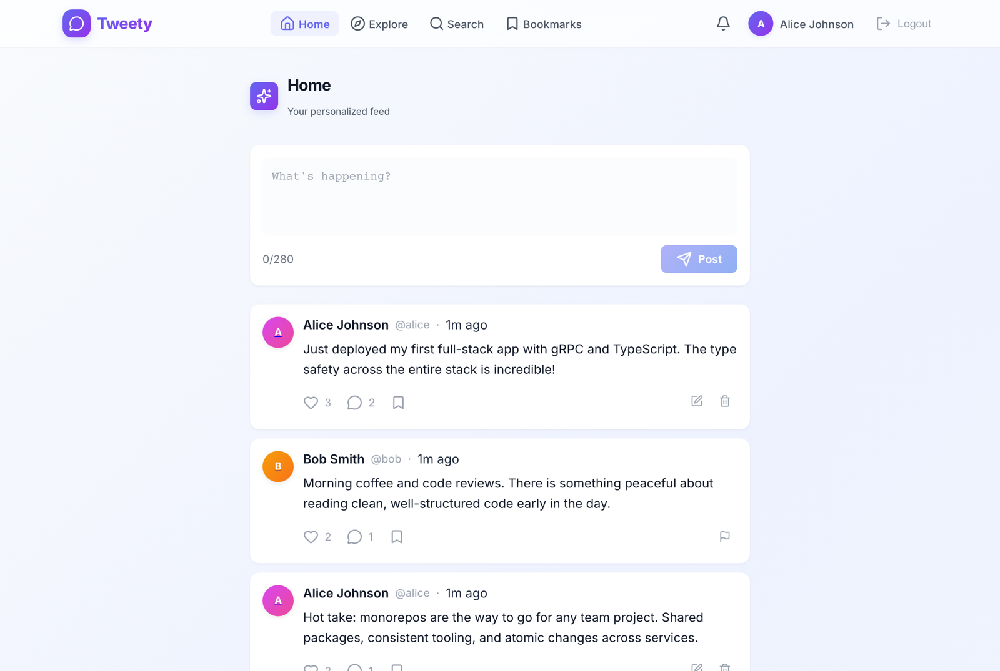
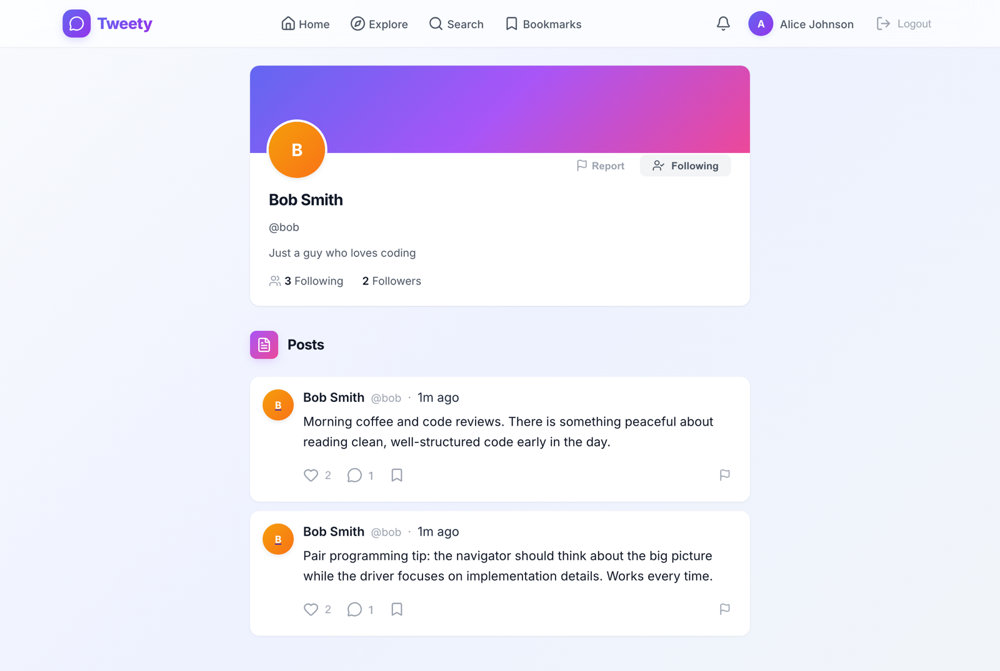
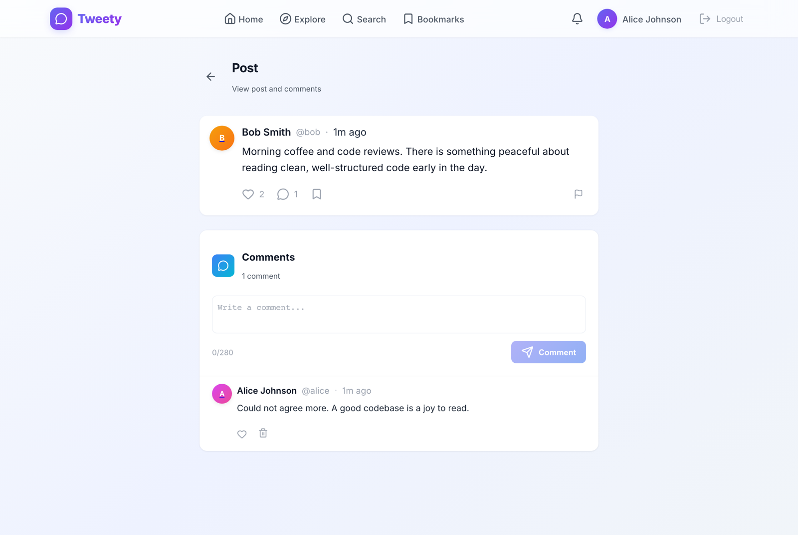
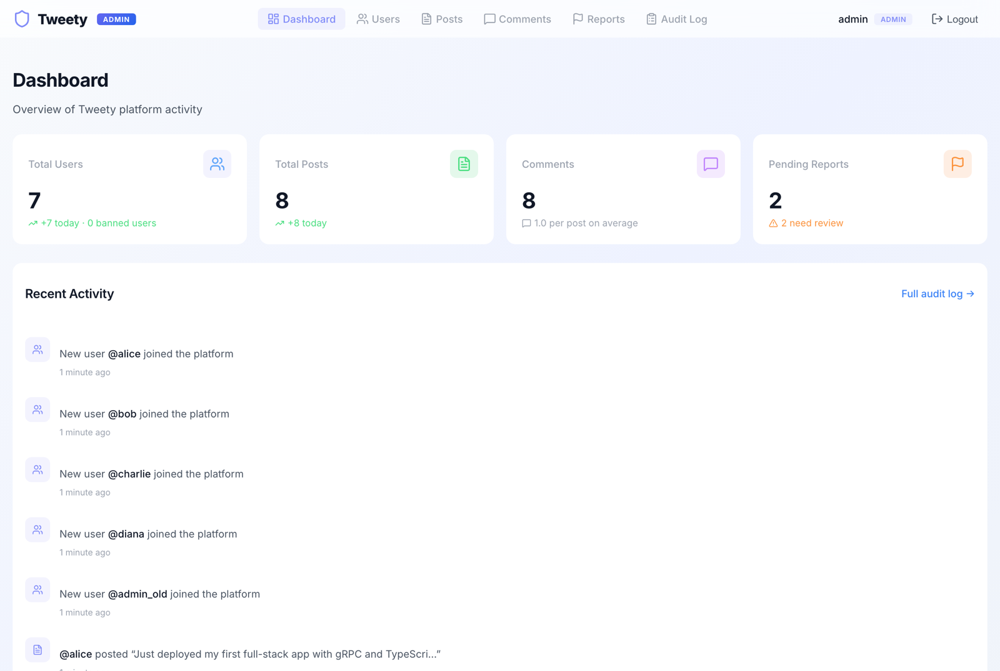
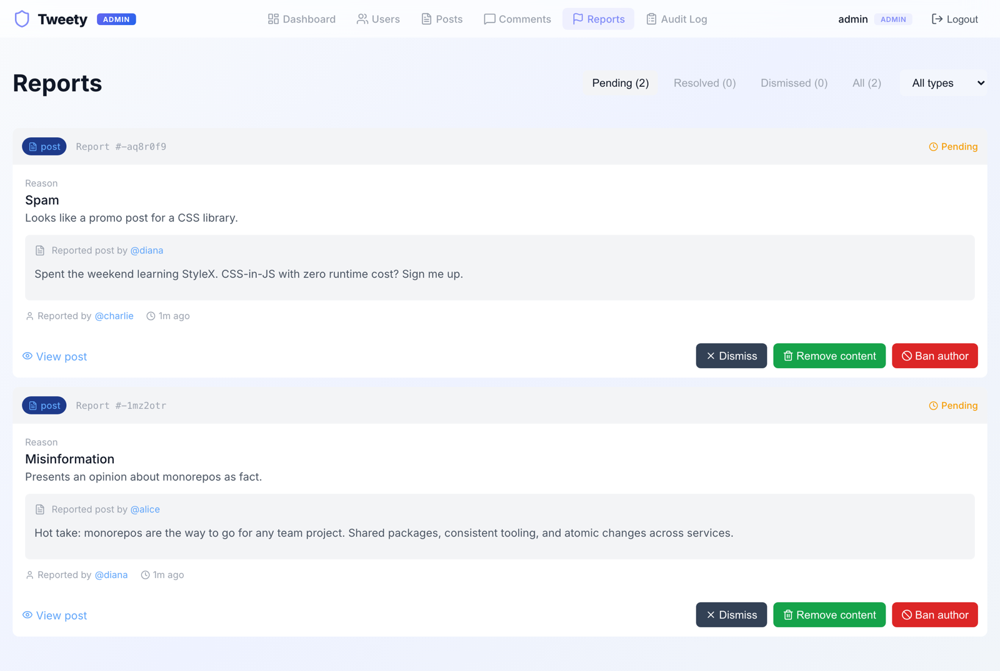
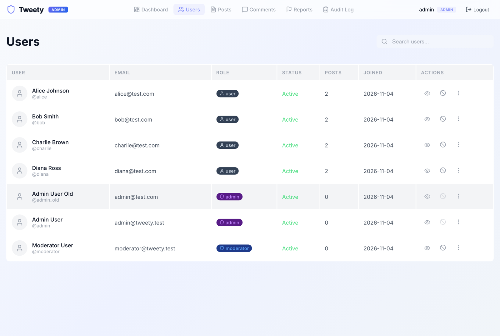

# Tweety

**A full-stack social app with a built-in moderation console.**

People sign up, post short updates (up to 280 characters), follow each other, like, comment, bookmark and get notified when others interact with them. Anyone can report a post, comment or account they think breaks the rules. Moderators work through those reports in a separate admin app, where they can remove content, ban accounts and see an audit trail of every action.



## Features

### Social app

- **Posts:** write, edit (within 5 minutes) and delete posts of up to 280 characters, with `@mentions`
- **Feed and discovery:** a personal feed of the people you follow, an Explore page and search for people and posts
- **Engagement:** likes, threaded comments with their own likes, bookmarks and follows
- **Notifications:** likes, comments, follows and mentions, with unread counts
- **Profiles:** bio, follower and following counts, and the user's posts
- **Reporting:** flag a post, comment or user with a reason and optional details. You can't report your own content, and you can't report the same thing twice while the first report is open.
- **Light and dark mode:** follows your system setting

### Admin console

- **Dashboard:** totals for users, posts, comments and pending reports, plus recent activity
- **Moderation queue:** tabs for pending, resolved and dismissed reports. Each report shows the reported content, who wrote it and who reported it.
  - **Dismiss:** close the report and leave the content alone
  - **Remove content:** delete the post or comment, which also resolves every other open report on it
  - **Ban author:** ban whoever posted it
- **Users:** search, view details and recent posts, ban and unban (a reason is required), and change roles
- **Posts and comments:** search, show only reported items, view a post with its comments and reports, and delete (a reason is required)
- **Audit log:** every moderator action, grouped by day and filterable by action type
- **Roles:** moderators can moderate content and ban users. Only admins can change roles. Nobody can ban themselves or change their own role.

## Screenshots

| | |
|---|---|
|  |  |
| **Profile:** follow or report a user | **Post detail:** comments, likes and actions |
|  |  |
| **Reporting:** pick a reason and add details | **Admin dashboard:** platform stats and activity |
|  |  |
| **Moderation queue:** review reports and act on them | **User management:** roles, bans and details |

## Getting started

You need **Node 22 or later** and **pnpm 9**. Running `corepack enable` installs the pinned pnpm version.

```bash
git clone https://github.com/jumppack/tweety-a-social-app.git
cd tweety-a-social-app
pnpm install       # installs dependencies and the git pre-commit hook
pnpm db:migrate    # creates the SQLite database (apps/api/tweety.db)
pnpm db:seed       # adds sample users, posts, comments and reports
pnpm dev           # starts the API, the social app and the admin console
```

| Service | URL |
|---|---|
| Social app | http://localhost:3000 |
| Admin console | http://localhost:3002 |
| API health check | http://localhost:3001/health (gRPC on port 50051) |

### Sample accounts

The seed creates these accounts so you can try both apps straight away:

| Account | Password | Can use |
|---|---|---|
| alice@test.com, bob@test.com, charlie@test.com, diana@test.com | `password123` | Social app |
| admin@tweety.test | `admin123` | Both apps (admin) |
| moderator@tweety.test | `mod123` | Both apps (moderator) |

To try the full moderation flow:
1. Sign in to the social app as Alice and report one of Bob's posts using the flag icon.
2. Sign in to the admin console as the moderator and open **Reports**.
3. Remove the post or ban Bob.
4. Check the **Audit Log** to see the action recorded.

## How it's built

```
apps/
  api/            Node.js gRPC API: business logic, auth, SQLite via Drizzle ORM
  client-user/    Social app (TanStack Start, React 19, server-side rendered)
  client-admin/   Admin console (TanStack Start, React 19)
packages/
  proto/          Protocol Buffer definitions shared by every app
  grpc-client/    Typed gRPC client used by both front ends
  db-schema/      Database schema and types
  ui/, shared-types/
```

The browser never talks to the API directly. Each front end calls its own server functions, and those call the API over gRPC with typed clients generated from the `.proto` files. The API issues and checks the session tokens.

- **Front end:** TanStack Start and Router, React 19, StyleX for styling with light and dark design tokens
- **API:** gRPC (`@grpc/grpc-js` and protobuf-ts), with a small Elysia HTTP server for health checks
- **Data:** SQLite through libSQL and Drizzle ORM
- **Security:** passwords hashed with scrypt; signed session tokens issued only by the API
- **Observability:** structured JSON logs and a trace ID on every request, sent back to the client in the gRPC metadata. Errors map to the right gRPC status codes.
- **Tooling:** pnpm workspaces, Turborepo, Biome, Vitest, Playwright, GitHub Actions

There is more detail in [architecture/ARCHITECTURE.md](architecture/ARCHITECTURE.md), and [DEVELOPMENT.md](DEVELOPMENT.md) covers day-to-day development.

## Development

```bash
pnpm lint          # Biome lint and format check (pnpm lint:fix to auto-fix)
pnpm typecheck
pnpm test:unit     # Vitest; the API tests use an in-memory SQLite database
pnpm test:e2e      # Playwright end-to-end tests for both apps
pnpm build
```

- **Pre-commit hook:** lints the staged files and typechecks the packages you changed.
- **CI:** runs lint, typecheck, unit tests and build on every pull request.
- **Before your first E2E run:** `pnpm --filter @tweety/client-user exec playwright install chromium`.
- **Resetting the data:** E2E tests write to the dev database. Reset it with `rm apps/api/tweety.db && pnpm db:migrate && pnpm db:seed`.

## Credits

Built on a starter codebase provided by Speechify.
