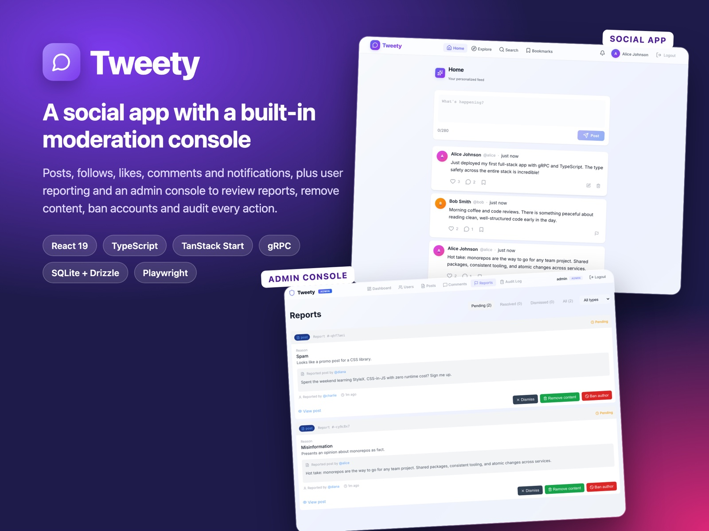
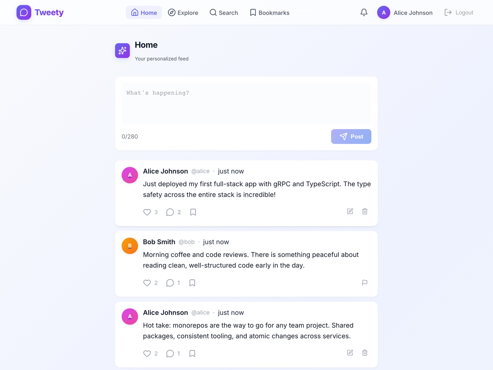
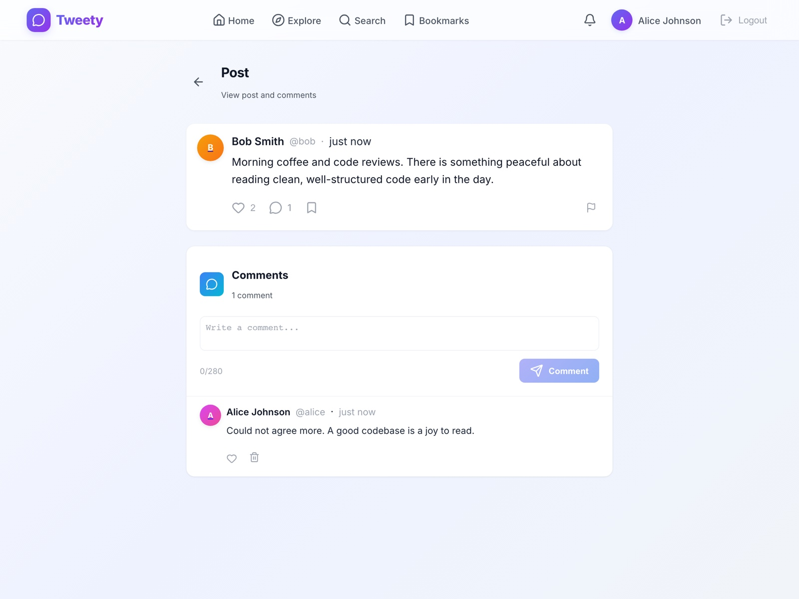
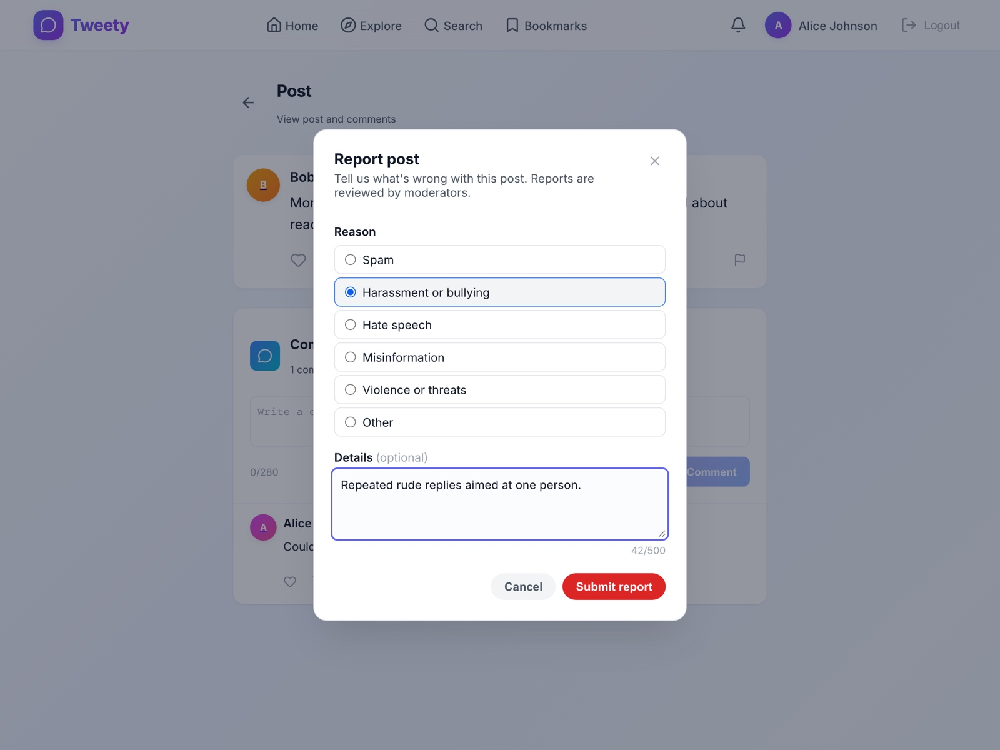
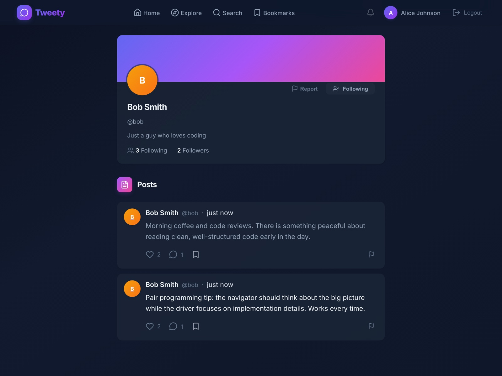
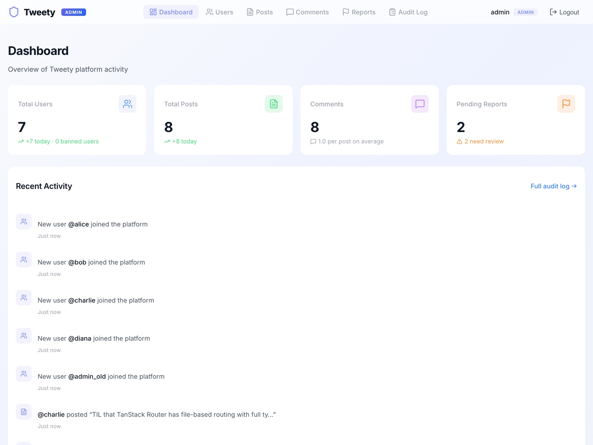
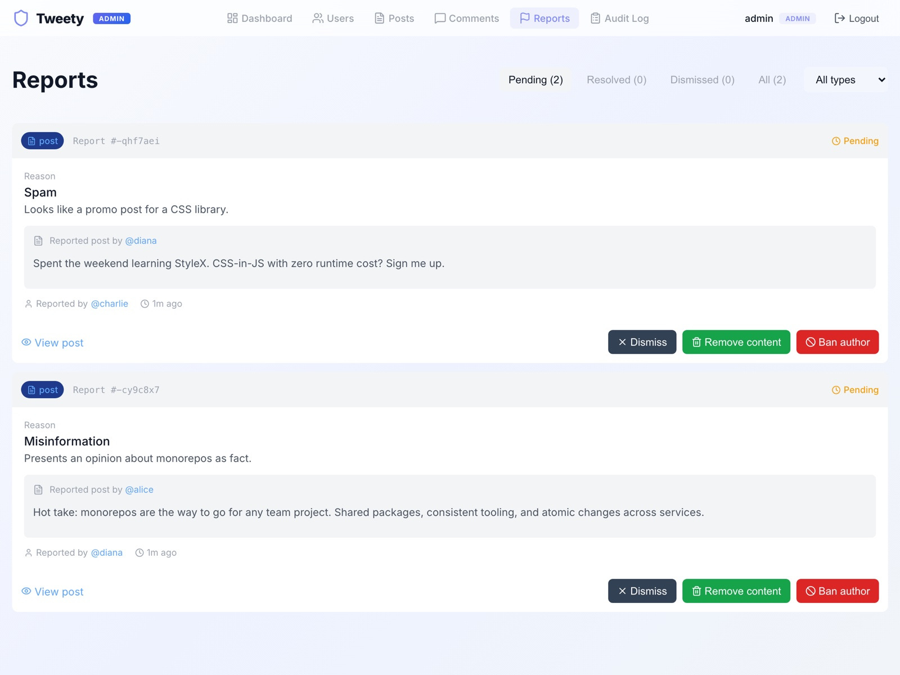
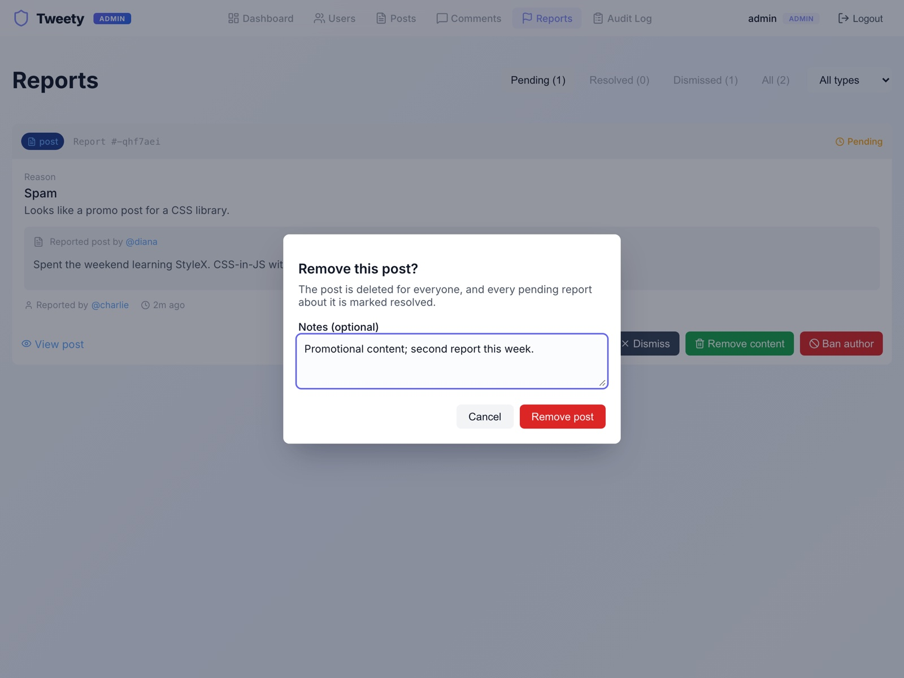
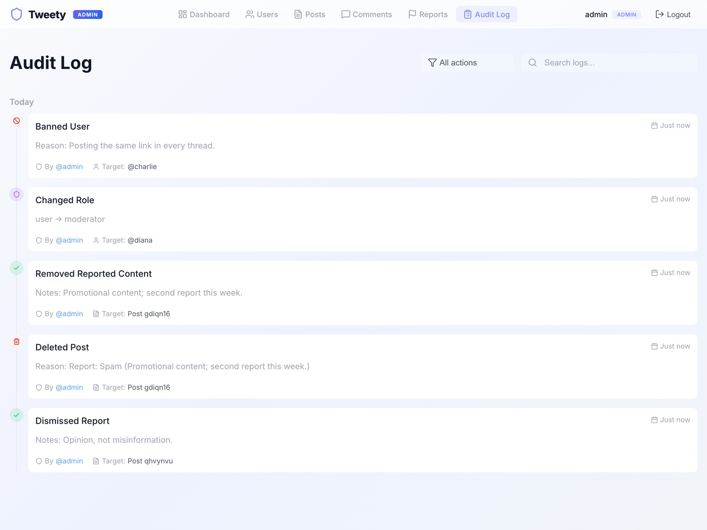

# Tweety

**A full-stack social app with a built-in moderation console.**

People sign up, post short updates (up to 280 characters), follow each other, like, comment, bookmark and get notified when others interact with them. Anyone can report a post, comment or account they think breaks the rules. Moderators work through those reports in a separate admin console, where they can remove content, ban accounts and see an audit trail of every action.



## Contents

- [Features](#features)
- [Screenshots](#screenshots)
- [Install and run](#install-and-run)
- [Using the app](#using-the-app)
- [How it's built](#how-its-built)
- [Development](#development)
- [Troubleshooting](#troubleshooting)

## Features

### Social app

- **Posts:** write, edit (within 5 minutes) and delete posts of up to 280 characters, with `@mentions`
- **Feed and discovery:** a personal feed of the people you follow, an Explore page and search for people and posts
- **Engagement:** likes, threaded comments with their own likes, bookmarks and follows
- **Notifications:** likes, comments, follows and mentions, with unread counts
- **Profiles:** bio, follower and following counts, and the user's posts
- **Reporting:** flag a post, comment or user with a reason and optional details. You can't report your own content, and you can't report the same thing twice while the first report is open.
- **Light and dark mode:** follows your system setting

### Admin console

- **Dashboard:** totals for users, posts, comments and pending reports, plus recent activity
- **Moderation queue:** tabs for pending, resolved and dismissed reports. Each report shows the reported content, who wrote it and who reported it.
  - **Dismiss:** close the report and leave the content alone
  - **Remove content:** delete the post or comment, which also resolves every other open report on it
  - **Ban author:** ban whoever posted it
- **Users:** search, view details and recent posts, ban and unban (a reason is required), and change roles
- **Posts and comments:** search, show only reported items, view a post with its comments and reports, and delete (a reason is required)
- **Audit log:** every moderator action, grouped by day and filterable by action type
- **Roles:** moderators can moderate content and ban users. Only admins can change roles. Nobody can ban themselves or change their own role.

## Screenshots

| | |
|---|---|
|  |  |
| **Home feed:** compose posts and see the people you follow | **Post detail:** comments, likes and actions |
|  |  |
| **Reporting:** pick a reason and add details | **Profiles:** follow or report a user, shown in dark mode |
|  |  |
| **Admin dashboard:** platform stats and activity | **Moderation queue:** review reports and act on them |
|  |  |
| **Review:** every action is confirmed, with optional notes | **Audit log:** a record of every moderator action |

## Install and run

### 1. Prerequisites

| Tool | Version | How to get it |
|---|---|---|
| [Node.js](https://nodejs.org/) | 22 or later | Download the LTS installer, or use a version manager such as `nvm install 22` |
| [pnpm](https://pnpm.io/) | 9 | Run `corepack enable` (ships with Node), which installs the version pinned in `package.json` |
| [Git](https://git-scm.com/) | any recent version | Needed to clone the repo |

Check them with `node -v`, `pnpm -v` and `git --version`. Tweety runs on macOS, Linux and Windows (WSL recommended). The database is a local SQLite file, so there's nothing else to install.

### 2. Get the code and install dependencies

```bash
git clone https://github.com/jumppack/tweety-a-social-app.git
cd tweety-a-social-app
pnpm install
```

`pnpm install` also sets up a git pre-commit hook that lints and typechecks your changes.

### 3. Create the database and add sample data

```bash
pnpm db:migrate    # creates apps/api/tweety.db
pnpm db:seed       # adds sample users, posts, comments, follows and two open reports
```

### 4. Start the app

```bash
pnpm dev
```

This generates the gRPC code, then starts all three services. The first start takes about 20–30 seconds. It's ready when the terminal shows `Tweety API started` and both web apps report their local URLs.

### 5. Open it in your browser

| What | URL | Sign in with |
|---|---|---|
| **Social app** | http://localhost:3000 | `alice@test.com` / `password123` |
| **Admin console** | http://localhost:3002 | `admin@tweety.test` / `admin123` |
| API health check | http://localhost:3001/health | (no sign-in; returns `{"status":"ok"}`) |

Press `Ctrl+C` in the terminal to stop everything.

## Using the app

### Sample accounts

| Account | Password | Role | Use it for |
|---|---|---|---|
| `alice@test.com` | `password123` | User | Social app |
| `bob@test.com` | `password123` | User | Social app |
| `charlie@test.com` | `password123` | User | Social app |
| `diana@test.com` | `password123` | User | Social app |
| `moderator@tweety.test` | `mod123` | Moderator | Admin console (moderate content, ban users) |
| `admin@tweety.test` | `admin123` | Admin | Admin console (everything, including role changes) |

You can also create your own account from the **Register** page of the social app.

### In the social app (http://localhost:3000)

1. **Sign in** as Alice. The **Home** feed shows posts from people she follows.
2. **Post something** in the "What's happening?" box (280 characters max) and press **Post**. Mention someone with `@bob`.
3. **Interact:** use the heart to like, the speech bubble to open the post and comment, and the bookmark icon to save it for later under **Bookmarks**.
4. **Find people** with **Explore** and **Search**, open a profile and press **Follow**.
5. **Check notifications** with the bell icon after another account likes, comments on or follows you. Sign in as Bob in a private window to try it.
6. **Report something:** on someone else's post or comment, click the flag icon, choose a reason, add details if you like and press **Submit report**. On a profile, use the **Report** button.

### In the admin console (http://localhost:3002)

1. **Sign in** as the moderator or the admin. The **Dashboard** shows totals and recent activity, and the Pending Reports card links to the queue.
2. **Open Reports.** The seed includes two open reports. Each card shows the reported content, its author, who reported it and why.
3. **Act on a report:**
   - **Dismiss** keeps the content.
   - **Remove content** deletes the post or comment.
   - **Ban author** blocks the author from signing in.

   Each action asks you to confirm and lets you add a note.
4. **Manage users** under **Users**: search, open a user, **Ban** or **Unban** them (a reason is required), or **Change Role** if you're signed in as the admin.
5. **Moderate content directly** under **Posts** and **Comments**. Use **Reported Only** to focus on flagged items.
6. **Review the history** under **Audit Log**. Every action above appears here with who did it, when and why. Filter it by action type.

### Try the full moderation flow

1. In the social app, sign in as **Alice**, open one of **Bob's** posts and report it.
2. In the admin console, sign in as the **moderator** and open **Reports**. Alice's report is at the top.
3. Choose **Remove content**. The post disappears from the social app.
4. Open the **Audit Log** to see the action recorded.

## How it's built

```
apps/
  api/            Node.js gRPC API: business logic, auth, SQLite via Drizzle ORM
  client-user/    Social app (TanStack Start, React 19, server-side rendered)
  client-admin/   Admin console (TanStack Start, React 19)
packages/
  proto/          Protocol Buffer definitions shared by every app
  grpc-client/    Typed gRPC client used by both front ends
  db-schema/      Database schema and types
  shared-types/   Types shared between the API and the front ends
db/migrations/    SQL migrations
docs/screenshots/ Images used in this README
```

The browser never talks to the API directly. Each front end calls its own server functions, and those call the API over gRPC with typed clients generated from the `.proto` files. The API issues and checks the session tokens.

- **Front end:** TanStack Start and Router, React 19, StyleX for styling with light and dark design tokens
- **API:** gRPC (`@grpc/grpc-js` and protobuf-ts), with a small Elysia HTTP server for health checks
- **Data:** SQLite through libSQL and Drizzle ORM
- **Security:** passwords hashed with scrypt; signed session tokens issued only by the API; role checks on every admin action
- **Observability:** structured JSON logs and a trace ID on every request, sent back to the client in the gRPC metadata. Errors map to the right gRPC status codes.
- **Tooling:** pnpm workspaces, Turborepo, Biome, Vitest, Playwright, GitHub Actions

There is more detail in [architecture/ARCHITECTURE.md](architecture/ARCHITECTURE.md), and [DEVELOPMENT.md](DEVELOPMENT.md) covers day-to-day development.

## Development

```bash
pnpm lint          # Biome lint and format check (pnpm lint:fix to auto-fix)
pnpm typecheck
pnpm test:unit     # Vitest; the API tests use an in-memory SQLite database
pnpm test:e2e      # Playwright end-to-end tests for both apps
pnpm build
```

- **Running one service:** `pnpm dev:api`, `pnpm dev:user` or `pnpm dev:admin`. The web apps need the API running.
- **Before your first E2E run:** install the browser with `pnpm --filter @tweety/client-user exec playwright install chromium`.
- **Changing the API contract:** edit the `.proto` files in `packages/proto/protos`, then run `pnpm proto:generate`. `pnpm dev` and `pnpm build` regenerate the code automatically.
- **Pre-commit hook:** lints the staged files and typechecks the packages you changed.
- **CI:** GitHub Actions runs lint, typecheck, unit tests and build on every push to `main` and every pull request.

### Production settings

Set these environment variables when deploying:

| Variable | Purpose |
|---|---|
| `GRPC_JWT_SECRET` | Signs session tokens. Required; the API won't start without it when `NODE_ENV=production`. |
| `SESSION_SECRET` | Encrypts the session cookies of both web apps (at least 32 characters) |
| `DATABASE_URL` | libSQL/SQLite connection string (default `file:./tweety.db`) |
| `GRPC_API_HOST` | Where the web apps reach the API (default `localhost:50051`) |

## Troubleshooting

| Problem | Fix |
|---|---|
| `Port 3000 is already in use` (or 3001, 3002, 50051) | Another process is using the port. Stop it, or find it with `lsof -i :3000` and end it. |
| Pages show errors right after starting | Wait until the API prints `Tweety API started`, then refresh. |
| The sample data is cluttered (for example, after running the E2E tests) | Reset it with `rm apps/api/tweety.db && pnpm db:migrate && pnpm db:seed`. |
| `pnpm: command not found` | Run `corepack enable`, then open a new terminal. |
| Errors about missing generated files | Run `pnpm proto:generate`, or just `pnpm dev`, which does it for you. |

## Credits

Built on a starter codebase provided by Speechify.
