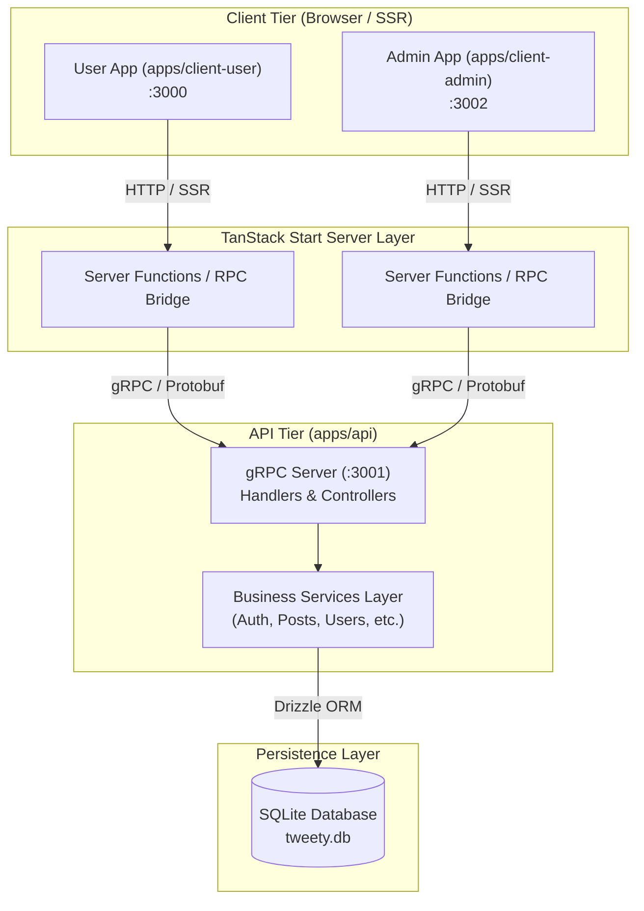
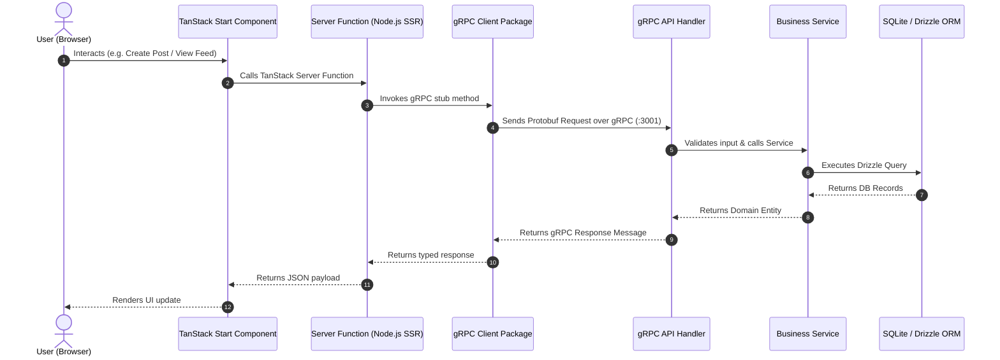
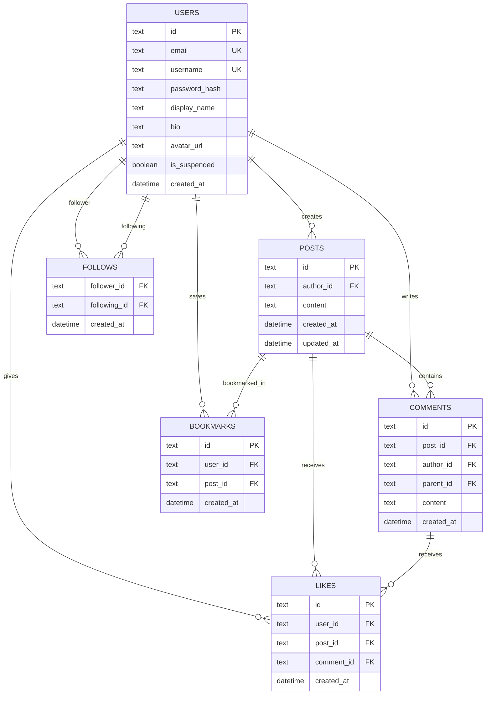

# Tweety Platform - Architecture Overview

## 1. System Overview & Technology Stack

Tweety is a full-stack social media platform engineered as a monorepo powered by **Turborepo** and **pnpm workspaces**.

```
+-------------------------------------------------------------------------------+
|                               Monorepo Architecture                           |
+-------------------------------+-------------------------------+---------------+
|       apps/client-user        |       apps/client-admin       |   apps/api    |
|   (TanStack Start + React 19)  |   (TanStack Start + React 19)  | (Node + gRPC) |
+-------------------------------+-------------------------------+---------------+
                                |                               |
                                v                               v
+-------------------------------------------------------------------------------+
|                              Shared Packages                                  |
|   packages/grpc-client  |  packages/proto  |  packages/db-schema  |  ...     |
+-------------------------------------------------------------------------------+
```

### Tech Stack Breakdown
- **Frontend Framework**: TanStack Start (React 19, SSR + Hydration, File-based routing via `@tanstack/react-router`)
- **Styling System**: Meta StyleX (`@stylexjs/stylex`) with compiled CSS atomic utility rules
- **API Protocol**: gRPC over HTTP/2 using `@grpc/grpc-js` and protobuf-ts generated types
- **Data Persistence**: SQLite via libSQL (`@libsql/client`) and **Drizzle ORM** (`packages/db-schema`)
- **Build & Monorepo Tooling**: Turborepo, Vite 6, `pnpm` workspaces, Biome for linting/formatting
- **Testing**: Vitest for unit/integration tests, Playwright for E2E testing

---

## 2. High-Level System Architecture Diagram



---

## 3. End-to-End Request & Data Flow (Sequence Diagram)



---

## 4. Domain & Use Case Model

```mermaid
mindmap
  root((Tweety Platform))
    User Application
      Authentication
        Login / Register
        Session Validation
      Content Feed
        Home Feed (Followed users)
        Explore Feed (All recent)
        Search (Posts & Users)
      Post Operations
        Create / Edit (5 min limit) / Delete
        Like / Bookmark
      Comments
        Threaded comments (1 level deep)
        Like comments
      User Profiles
        Follow / Unfollow
        Profile management
    Admin Application
      Dashboard Stats
      User Moderation (Suspend/Unsuspend)
      Content Moderation (Delete posts/comments)
      Audit Logs & Reports
```

---

## 5. Database ERD (Entity Relationship Diagram)



---

## 6. Key UI Layout & Mock Architecture

### User Client Interface Mock Structure
```
+-----------------------------------------------------------------------------------+
|  [Sidebar Navigation]    |  [Main Feed View]                | [Right Panel]       |
|  - Home                  |  +-----------------------------+  | - Search Bar        |
|  - Explore               |  | Compose Box (Max 280 chars) |  | - Who to follow     |
|  - Bookmarks             |  +-----------------------------+  | - Trending tags     |
|  - Profile               |  | Feed Post Item              |  |                     |
|  - Settings              |  |  - User Avatar & Name       |  |                     |
|                          |  |  - Post Content Text        |  |                     |
|                          |  |  - Actions: Like/Bookmark   |  |                     |
|                          |  +-----------------------------+  |                     |
+-----------------------------------------------------------------------------------+
```
